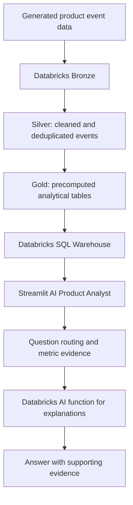

# Product Growth Intelligence

An end-to-end product analytics project that turns event-level e-commerce data into decision-ready funnel, retention, experiment, and category-economics insights. A Streamlit AI Product Analyst lets users ask questions in natural language and receive explanations grounded in precomputed Gold-layer analytics.

>
## Business questions

- Where are users dropping out of the product funnel?
- Which acquisition channels have stronger or weaker D30 retention?
- Is feature adoption associated with retention?
- Which product categories contribute revenue and gross profit?
- What do experiment results suggest, and how certain are they?
- How can a non-technical stakeholder understand product-growth metrics?

## Architecture

The database tables are the source of truth for reported metrics. The language model explains retrieved evidence; it should not be treated as the authority for numeric results.

See [`docs/architecture.md`](docs/architecture.md) and [`architecture/architecture.mmd`](architecture/architecture.mmd).

## Data overview

The project uses a generated e-commerce/product-growth dataset. Recorded source sizes before event deduplication:

| Dataset | Rows | Columns |
|---|---:|---:|
| Users | 100,000 | 6 |
| Products | 5,000 | 6 |
| Sessions | 992,464 | 6 |
| Events | 9,536,511 | 13 |
| Experiments | 3 | 10 |
| Releases | 9 | 5 |

The event Silver layer contains **9,498,495 rows** after duplicate event IDs were removed. These figures describe the project data as recorded during development; rerun validation if the underlying tables change.

## Selected findings

These are findings recorded during project analysis. They are descriptive or observational unless explicitly identified as experiment-test results.

- **Product funnel:** 683,245 product-view sessions, 87,055 add-to-cart sessions, 48,549 checkout sessions, and 39,149 purchase sessions. Reported product-view-to-purchase conversion was 5.73%.
- **Search association:** conversion was 6.50% for search sessions versus 2.20% for sessions without search. This is an association, not proof that search caused the difference.
- **D30 retention:** overall cohort D30 retention was 4.60% (1,191 retained of 25,888 users in the analyzed cohort).
- **Acquisition channel:** Paid Social D30 retention was 2.03% versus 5.55% for other channels in the recorded analysis. This comparison is observational.
- **Feature adoption:** adopters had 21.46% D30 retention versus 3.54% for non-adopters. Selection effects and possible immortal-time bias mean this is not a causal estimate.
- **Category funnel:** Home had a 45.10% checkout-to-payment-attempt drop-off in the recorded analysis. A payment attempt is not the same as a successful payment.
- **Category economics:** Electronics contributed 2.167M in revenue and 256.8K in gross profit, with an 11.85% gross margin. Fashion gross margin was 54.72%; Beauty gross margin was 57.33%. Currency/unit conventions should be checked against the source data before external publication.
- **Promotions:** promoted sessions were associated with approximately 22% higher conversion, while margins were about 3 percentage points lower and profit per converted session was 12–18% lower in the recorded comparison. Do not describe these differences as causal.

More detail and caveats: [`docs/business_findings.md`](docs/business_findings.md).

## Portfolio links

- **Live AI Product Analyst:** [Launch the app](https://appuct-growth-ai-analyst-app-en72jecgo9kfsvtakmmhnp.streamlit.app/)
- **Main repository:** [product-growth-ai-analyst](https://github.com/HaarisShk/product-growth-ai-analyst)
- **App source repository:** [product-growth-ai-analyst-app](https://github.com/HaarisShk/product-growth-ai-analyst-app)

## BI dashboard

The Power BI report presents the executive overview, growth and retention, and product economics. 

## AI Product Analyst

The Streamlit app supports questions about:
- Product funnel
- D30 retention and acquisition channels
- Feature adoption and retention
- Category funnel and payment-attempt drop-off
- Category revenue, gross profit, and margin
- Experiment summaries
- Daily metrics
- Product-growth terminology and formulas

**Live demo:** [Open the deployed AI Product Analyst](https://appuct-growth-ai-analyst-app-en72jecgo9kfsvtakmmhnp.streamlit.app/)

## Repository contents

- `notebooks/`: cleaned Databricks notebook exports for auditing, Silver transformation, Gold analytics, validation, product performance, promotion economics, and AI SQL examples.
- `docs/`: architecture, data definitions, methodology, findings, and notebook cleanup notes.
- `architecture/`: Mermaid architecture diagram source.
- Add actual standalone SQL files only if they were used in the implementation; do not create placeholder SQL and claim it is production code.

## Limitations

1. The data is generated/synthetic, so findings are a demonstration of analytical workflow, not evidence about a real company's customers.
2. Observational differences do not establish causation.
3. Feature-adoption comparisons can be affected by selection and timing bias.
4. Experiment conclusions depend on the randomization, sample, metric definition, and test assumptions. Do not call an experiment significant unless its test result supports that statement.
5. Payment attempts are not confirmed successful payments.
6. AI-generated narrative can still be wrong. Verify numeric claims against the supporting Gold-table evidence.
7. Results may change if the underlying tables or metric definitions change.

## Reproducing / reviewing the project

The live app uses an existing Databricks environment and is not fully reproducible from this repository alone. To review the project:

1. Read the data dictionary and metric definitions.
2. Review the notebooks and SQL that are actually committed.
3. Review the methodology and limitations before interpreting findings.
4. Use the live app to ask a focused question and inspect its supporting evidence.
5. Keep all Databricks credentials in the deployment platform's Secrets settings.

## Security

Never commit access tokens, passwords, connection strings containing credentials, private datasets, or Streamlit Secrets. Use a read-only Databricks identity for the app where supported.

