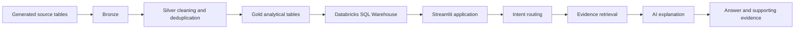

# Architecture

## Overview

The project separates event preparation, analytical metric tables, and the user-facing explanation layer.

1. **Source data:** generated users, products, sessions, events, experiments, and release records.
2. **Bronze layer:** raw ingested records.
3. **Silver layer:** cleaned/standardized events, including deduplication by event ID. Recorded row counts: 9,536,511 Bronze events and 9,498,495 Silver events.
4. **Gold layer:** precomputed analytical tables for the supported business questions.
5. **Databricks SQL Warehouse:** serves read queries to the app.
6. **Streamlit app:** routes questions to supported analytical topics, retrieves relevant Gold-table evidence, and formats the answer.
7. **AI explanation layer:** uses a Databricks AI function to explain evidence or answer product-growth education questions.

## Data flow

## Gold evidence areas

The deployed app has been documented as using these analytical areas/tables:

| Topic | Gold table |
|---|---|
| D30 retention | `gold_d30_retention` |
| Feature adoption and retention | `gold_feature_retention` |
| Category funnel | `gold_category_funnel` |
| Category economics | `gold_category_economics` |
| Experiments | `gold_experiment_results` |
| Daily metrics | `gold_daily_metrics` |
| Overall product funnel | `gold_product_funnel` |

Confirm catalog/schema names and table definitions in the actual Databricks workspace; they are intentionally not hard-coded into this documentation.

## Design principles

- The analytical tables, not the language model, are the numeric source of truth.
- The app should show supporting evidence for analytical answers.
- Credentials are stored in Streamlit Secrets, not in source control.
- The app should use least-privilege, read-only database access.
- Observational findings must not be phrased as causal effects.
- Avoid rebuilding working Gold tables merely to reorganize documentation.
